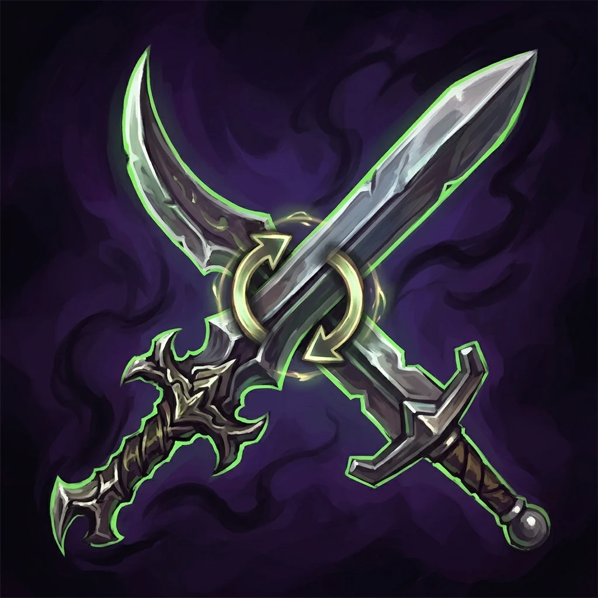

# WeaponSwap

<p align="center"></p>

A rogue addon for [WoW Forever](https://www.wowhead.com/forever) that keeps a dagger
in your main hand for the opener and a sword for the rest of the fight. You pick the
two weapons once; after that, macros and automatic swaps move them in and out.

On Forever, Backstab and Ambush need a dagger in the main hand. WeaponSwap puts the
dagger in when you stealth and brings the sword back right after the opener. In the
middle of a fight, one key press swaps for you.

```
 Stealth ──► dagger in ── opener ──► sword back ── Sinister Strike, Slice and Dice ...
              (auto)      Ambush       (auto)
                          Backstab
                          Cheap Shot
                          Garrote

 Stealth drops, no fight ──► sword back (auto)
 Fight ends ──────────────► sword back (auto), or the dagger if you are still stealthed
```

## Install

Get it from [CurseForge](https://www.curseforge.com/wow/addons/rogue-weaponswap)
with the CurseForge app, or by hand:

1. Download the zip from [CurseForge](https://www.curseforge.com/wow/addons/rogue-weaponswap)
   (or this repository).
2. Copy the `WeaponSwap` folder to
   `World of Warcraft\_forever_\Interface\AddOns\WeaponSwap`.
3. Log in, or `/reload` if you are already in game.

## Setup

1. Type `/ws` to open the window.
2. Drag your dagger onto the top slot and your sword onto the bottom one.
3. Click Create / update. This creates six character macros.
4. Drag the macro icons next to the button onto your action bar.
5. Tick the automatic swaps you want.

```
┌────────────── WeaponSwap ───────────────┐
│ [D]  Dagger (Backstab / Ambush)         │
│       Edward's Knife                    │
│ [S]  Sword                              │
│       Vileblood Scimitar                │
│ [Create / update] [B][A][S][SS][SD][GS] │
│ ☑ Dagger when entering stealth          │
│ ☑ Sword when leaving stealth            │
│ ☑ Sword when combat ends                │
│ ☑ Sword after the opener                │
│ ☐ Pick Pocket before Ambush             │
│ ☐ Debug log (/reload saves it)          │
└─────────────────────────────────────────┘
```

Left-click a slot to equip that weapon, right-click to clear it.

## Macros

| Macro | One press |
|---|---|
| WS Backstab | puts the dagger in if it is not there, then Backstab |
| WS Ambush | puts the dagger in if it is not there, then Ambush |
| WS Sinister | Sinister Strike, then puts the sword back if the dagger is in |
| WS Slice | Slice and Dice, then puts the sword back if the dagger is in |
| WS Sword | puts the sword back |
| WS Ghostly | puts the dagger in if it is not there, then Ghostly Strike out of stealth; the next presses Ambush while its buff lasts, Backstab after |

All six work in combat. Sinister Strike and Slice and Dice do not need a sword, so
those macros hit first and swap after, on the same press. Backstab and Ambush need the
dagger first. If the sword is in, the first press swaps and starts the global
cooldown, and the next press hits.

With "Pick Pocket before Ambush" ticked, WS Ambush casts Pick Pocket and then Ambush
on the same press: Pick Pocket has no global cooldown. Ambush still needs you behind
the target; Pick Pocket does not, so from the front only Pick Pocket goes off. On a
target already robbed or not humanoid, Pick Pocket shows an error and Ambush goes off
anyway. Turn on Auto Loot.

WS Ghostly is for openers out of stealth. Ghostly Strike (20 s cooldown) makes the next
Ambush within 7 s skip the Stealth requirement. While Ghostly Strike is on cooldown,
that line fails and the macro moves on to Ambush; once the buff is gone, Ambush fails
too and Backstab goes. In stealth it skips Ghostly Strike and goes straight to Ambush.
Ambush and Backstab still need you behind the target.

## Automatic swaps

| Option | Swaps when |
|---|---|
| Dagger when entering stealth | you stealth |
| Sword when leaving stealth | stealth drops without a fight |
| Sword after the opener | Ambush, Backstab, Cheap Shot or Garrote lands from stealth |
| Sword when combat ends | the fight is over (the dagger instead, if you are still stealthed, e.g. after Vanish) |

After login, `/reload`, a loading screen or a resurrection, and when you tick an
option, WeaponSwap also puts in the weapon those options want right away: the dagger if
you are stealthed and "Dagger when entering stealth" is on, the sword if you are not
stealthed and "Sword when leaving stealth" or "Sword when combat ends" is on.

These only run out of combat, because the game does not let an addon swap gear in
combat on its own. "Sword after the opener" still fires after an opener from
stealth: the game reports the cast a moment before it flags you as in combat. If a mob
pulls you first, it cannot fire. Press WS Sinister or WS Slice then, or let "Sword when
combat ends" bring the sword back.

## How it works

WoW Forever blocks addon code from equipping items in combat, even from a key press.
The game's own macro commands are allowed, so the macros never call the addon. Each
one holds a plain `/equipslot` line:

```
#showtooltip Sinister Strike
/cast Sinister Strike
/equipslot [equipped:Daggers] 16 0 7
```

`16` is the main hand, and `0 7` is the bag slot of the weapon that is not in your
hand. When one weapon goes in, the other drops into the slot it left, so the slot
stays the same from swap to swap. `[equipped:Daggers]` stops the macro from swapping
when you already hold the right weapon.

A bag slot points at one exact item. With two copies of the same sword in main hand
and off hand, equipping by name could grab the off-hand one; the bag slot can't. When
your bags change, WeaponSwap rewrites the slot in the macros as soon as you are out of
combat.

## Commands

| Command | |
|---|---|
| `/ws` | open or close the window (`/WS` works too) |
| `/ws dagger`, `/ws sword` | equip one, out of combat |
| `/ws debug` | turn the debug log on or off |
| `/ws help` | list the commands |

## Debug log

Tick Debug log (or type `/ws debug`) and WeaponSwap records combat and stealth
changes, each swap and the bag slot it came from, casts, failed casts and the red
error text. It writes nothing to chat. Each login or `/reload` starts a fresh log. After a `/reload`, the previous session (up to 2000 lines) is in
`WTF\Account\<account>\<realm>\<character>\SavedVariables\WeaponSwap.lua`. Paste them
in an issue when something goes wrong.

## Compatibility

Built and tested on WoW Forever (interface 16001) in November 2026. It assumes one
dagger and one or two swords, since `[equipped:Daggers]` is how it tells the two modes
apart. Other Classic clients may work after bumping the interface number in the
`.toc`, but the combat rules above were only checked on Forever.

## License

MIT. See [LICENSE](LICENSE).
