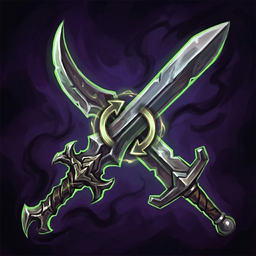

*Dagger for the opener, sword for the rest of the fight.*

On WoW Forever, Backstab and Ambush need a dagger in the main hand. Rogue WeaponSwap keeps a dagger and a sword ready and moves them for you: the dagger goes in when you stealth, the sword comes back after the opener, and one key press swaps in the middle of a fight. You pick the two weapons once by dragging them into a small window. No item names to type, no bags to open.

## At a glance

- **Opener macros:** WS Backstab and WS Ambush put the dagger in, then strike. WS Ghostly opens out of stealth with Ghostly Strike, then Ambush.
- **Swap back on the hit:** WS Sinister, WS Hemorrhage and WS Slice use Sinister Strike, Hemorrhage or Slice and Dice and put the sword back on the same press. One checkbox adds `/startattack` to WS Sinister and WS Hemorrhage.
- **Works in combat:** the macros use the game's own `/equipslot`, which Forever allows in combat.
- **Automatic swaps out of combat:** dagger when you stealth, sword after the opener, when stealth drops, or when the fight ends. Each one is a checkbox.
- **Two identical swords:** a main-hand and an off-hand copy of the same sword are fine. The macros pick the copy in your bags, never the one in your off hand.
- **Sword and dagger in both hands:** with the sword in the main hand and the dagger in the off hand, the macros swap your hands instead.
- **Debug log:** one checkbox records swaps, casts and error messages, for bug reports.

## Getting started

1. Type `/ws` to open the window.
2. Drag your dagger onto the top slot and your sword onto the bottom one.
3. Click **Create / update**. This creates seven character macros.
4. Drag the macro icons from the window onto your action bar.
5. Tick the automatic swaps you want.

The macros keep themselves up to date. When your bags change or you drag in a new weapon, the addon rewrites them as soon as you are out of combat.

## The macros

| Macro | One press |
|---|---|
| WS Backstab | dagger in if needed, then Ambush in stealth, Backstab out of it |
| WS Ambush | dagger in if needed, then Ambush |
| WS Sinister | Sinister Strike, then sword back if the dagger is in |
| WS Hemorrhage | Hemorrhage, then sword back if the dagger is in |
| WS Slice | Slice and Dice, then sword back if the dagger is in |
| WS Sword | sword back |
| WS Ghostly | out of stealth: Ghostly Strike and dagger in, then Ambush on the next press |

Backstab and Ambush need the dagger before they can hit. If the sword is in, the first press swaps (which starts the global cooldown) and the next press hits.

## Works with Rogue Poison

[Rogue Poison](https://github.com/RafaelHGOliveira/RoguePoison) is a companion addon. When a weapon has no poison, it shows a bar at the top of the screen with the poisons in your bags, and a click coats that weapon. It reads the dagger and sword saved in WeaponSwap, so it also watches the one waiting in your bags: poison it there and it comes out poisoned at the next swap. Each addon works without the other.

## Slash commands

- `/ws`: open or close the window (`/WS` works too)
- `/ws dagger`, `/ws sword`: equip one, out of combat
- `/ws debug`: turn the debug log on or off
- `/ws help`: list the commands

## FAQ

**Why doesn't the sword come back on its own in combat?**
Forever does not let an addon swap gear in combat by itself. After an opener from stealth it still works, because the game reports the cast a moment before it flags you as in combat. If a mob pulls you first, press WS Sinister or WS Slice, or let "Sword when combat ends" do it.

**WS Backstab looks greyed out while I hold the sword.**
The game greys out Backstab without a dagger, even though the macro swaps first. Press it anyway: it swaps, and the next press hits. Forever hides your energy value from addons, so the addon cannot recolor the button.

**Something went wrong. What do I send?**
Tick Debug log, reproduce the problem and `/reload`. Then attach `WTF\Account\<account>\<realm>\<character>\SavedVariables\WeaponSwap.lua` to an issue on GitHub.

## Supported versions

WoW Forever (1.60.1). Other Classic clients are untested.

## Feedback and source

Bug reports, ideas and source code: [github.com/RafaelHGOliveira/WeaponSwap](https://github.com/RafaelHGOliveira/WeaponSwap). MIT license.
